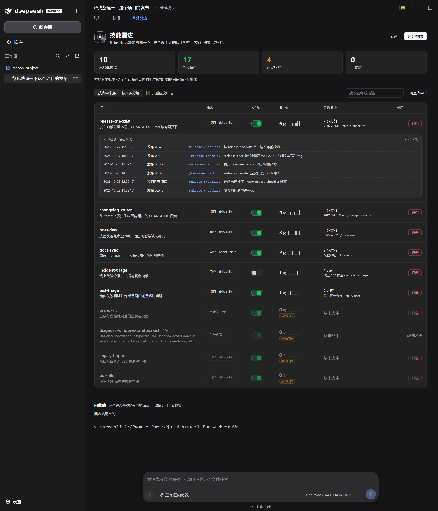

# dsh-skill-radar · 技能雷达

给 DeepSeek Harness 的技能面板加一列**命中记录**：每一个技能最近被谁、在哪个会话、用什么词触发过；按最近 7 天的命中数排序；零命中的技能灰显并标「建议归档」。

装了很多插件和技能之后，「有哪些技能」不是问题，「哪些技能真的在被用」才是。这个面板用本地账本回答后者。



> 截图在真实的 DSH Web 会话里渲染，深色主题，使用演示数据（10 个技能、17 次命中），并展开了 `release-checklist` 的命中记录。截图只用于展示界面，数字不是真实用户数据。

## 为什么做这个

- DSH 的技能服务能列出技能、能启停模型调用，但不告诉你技能有没有被调用过。
- 20 多个插件、几十个技能之后，判断「留哪个」只能靠感觉；0.2 的 `skills` 服务又按 preset 隔离，host 侧没有现成的全量视图。
- 这个插件自己做两件事：从 `tools/result` 和 `session/event` 里记下**每一次真实的技能命中**，再把结果按 7 天窗口排给你看。

## 和原版 dsh-skill-explorer 的关系

设计与灵感来自 **[zhu1090093659/dsh-web · packages/dsh-skill-explorer](https://github.com/zhu1090093659/dsh-web/tree/dev/packages/dsh-skill-explorer)**（Apache-2.0）。原版已经解决了「浏览技能、启停模型调用、把技能移进 `.trash` 回收站」。

本项目是**独立实现**：没有 fork，没有 clone 后改，没有复制原版代码或资源文件；只沿用了「技能面板 + `.trash` 归档 / 恢复」这一产品思路。两者的路由、数据格式、前端组件、测试都是各自独立的。

| | dsh-skill-explorer | dsh-skill-radar |
| --- | --- | --- |
| 回答的问题 | 我有哪些技能 | 哪些技能真的被用过 |
| 命中记录 | 无 | 每次命中的时间、会话、触发词、提示词 |
| 排序 | 目录顺序 | 最近 7 天命中数，7 天内零命中标「建议归档」 |
| 归档 | `<skill root>/.trash` | 同样走 `<skill root>/.trash`，可恢复 |
| 视图位置 | 自己的页面 / 路由 | `conversation.view` 里的「技能雷达」标签页 |
| 运行时依赖 | — | 零依赖（只用 Node 内建模块 + harness 提供的 React） |
| 许可证 | Apache-2.0 | MIT（本仓库原创代码） |

原版仓库的短 slug `zhu1090093659/dsh-web--packages-dsh-skill-explorer` 在实现时返回 404；上面的链接是实际存在的 `dev` 分支子目录。如果原版作者认为这里的命名或描述需要调整，欢迎开 issue。

## 功能

- **命中账本**：`tools/result`（模型调用 `skill` 工具）与 `session/event`（用户输入 `/skill-name`）两条路径都记；失败调用、非 `skill` 工具不记。
- **命中记录列**：7 次日历柱状图 + 计数；展开某一行可看到最近 6 次命中的精确时间、会话标题、触发词和当时的提示词，其余折叠为总数。
- **7 天排序**：按 `hits7` 降序、最近命中时间降序、名称升序；同一技能同一会话 30 秒内的重复命中只算一次（手势优先于工具调用）。
- **建议归档**：7 天内 0 次命中的行整体灰显，带琥珀色「建议归档」徽标；「只看建议归档」可一键过滤。
- **启停模型调用**：直接改 `SKILL.md` 的 `disable-model-invocation`，只动这一行，其余字节原样保留。
- **新建技能**：用户级 `~/.dsh/skills` 或项目级 `.dsh/skills`；kebab-case 校验、不覆盖同名、正文上限 64KB。
- **归档与恢复**：归档移动到该技能根目录下的 `.trash/YYYYMMDD-HHmmss-<entry>`；恢复时重新扫 `.trash` 匹配条目，拒绝未知 id 和冲突路径。
- **只读技能**：插件 / 注册表提供的技能会列出来，但标记「只读」，不能从本地文件启停或归档。
- **来源视野**：项目 `.dsh/skills`、项目 `.agents/skills`、运行时注册表、自定义目录、用户 `~/.dsh/skills`、`~/.agents/skills`、系统内置；同名按来源优先级去重。
- **本地**：没有对外网络请求，面板只轮询本机 `/dsh-skill-radar/state`；没有遥测，账本只写本机 `$DSH_HOME/skill-radar/hits.jsonl`。

## 安装

要求 DSH `>=0.2.0-rc.2 <0.3.0`。本仓库在 DSH **0.2.0-rc.2** 的 Web 运行时里实测通过（52 个测试 + 真实渲染）。

从 GitHub 安装到 desktop profile（先把桌面端完全退出，避免文件被占用）：

```bash
dsh plugin --profile desktop add github:dingchenhui0618-arch/dsh-skill-radar
```

插件管理器会在安装后把 `dsh-skill-radar` 加进 profile 的 `dsh.profile.bundles`；重启 DSH，在任意会话顶部切到「技能雷达」。

从源码开发：

```bash
git clone https://github.com/dingchenhui0618-arch/dsh-skill-radar.git
cd dsh-skill-radar
npm test
dsh plugin --profile desktop add .
```

卸载：

```bash
dsh plugin --profile desktop remove dsh-skill-radar
```

> 安装命令依赖 `pnpm` 在 PATH 上；DSH 的插件安装/更新走 pnpm。`dsh plugin --help` 会把未知参数交给 pnpm，所以直接 `add` / `remove` 即可。

## 配置

在 profile 的 `cordis.patch.yml` 里按 id 覆盖：

```yaml
- id: dsh-skill-radar
  config:
    windowDays: 7
    customSkillDirs:
      - D:/work/team-skills
    allowRemote: false
```

| 键 | 默认 | 说明 |
| --- | --- | --- |
| `windowDays` | `7` | 排序与「建议归档」的窗口天数 |
| `retentionDays` | `30` | 账本保留天数，启动时裁掉更早的行 |
| `maxHits` | `5000` | 账本最多保留的命中条数 |
| `hitsPath` | `$DSH_HOME/skill-radar/hits.jsonl` | 账本路径 |
| `agentsHome` | `$DSH_AGENTS_HOME` 或 `~/.agents` | `.agents/skills` 的根 |
| `customSkillDirs` | `[]` | 额外技能根，只读扫描 |
| `allowRemote` | `false` | 允许非 loopback 访问面板 API；默认只允许本机 |

## 命中是怎么记的

账本是一行一个 JSON 的 `hits.jsonl`：

```json
{"at":1793090357000,"name":"release-checklist","session":"session-7c30...","title":"发布 v0.4.0","trigger":"/release-checklist","prompt":"准备发 v0.4.0","via":"gesture","cwd":"D:/work/app"}
```

- `tools/result`：`exec.name === "skill"`、参数里的 `name` 合法、`result.isError !== true` 才记；触发词优先从最近的用户消息里找 `/name`，找不到就记技能名。
- `session/event`：`user/message` 且 `data.source.kind === "skill-invocation"`，说明用户按了 `/name`；`via` 为 `gesture`。
- 同一 `session + name` 在 30 秒内重复出现只保留一条，`gesture` 覆盖 `tool`。
- 只记插件加载之后的调用；更早的历史不会补记。账本损坏的行会被跳过，不影响其余数据。
- 排序先按窗口内命中数，再按最近命中时间（窗口外也保留最后一次时间），最后按名称；不依赖会话文件。

## HTTP 接口

面板通过同源接口读写，所有响应 `cache-control: no-store`：

| 方法 | 路径 | 说明 |
| --- | --- | --- |
| GET | `/dsh-skill-radar/health` | 健康检查、窗口天数、账本路径、账本行数 |
| GET | `/dsh-skill-radar/state?cwd=<dir>` | 完整状态：技能、分组、命中、回收站、统计 |
| POST | `/dsh-skill-radar/toggle` | `{name, path, enabled}` |
| POST | `/dsh-skill-radar/create` | `{name, description, whenToUse?, content?, scope}` |
| POST | `/dsh-skill-radar/archive` | `{name, path}` |
| POST | `/dsh-skill-radar/restore` | `{id}` |
| POST | `/dsh-skill-radar/clear-hits` | `{confirm: true}` |

安全边界：

- 默认只接受 loopback 请求（同时检查 `remoteAddress` 和 `Host`），远程访问需要显式 `allowRemote: true`。
- 所有 POST 必须带 `x-dsh-skill-radar: 1`；带 `Origin` 时必须是同源或 loopback。
- 写操作只落在按当前 `cwd` 解析出的技能根内（项目 `.dsh/skills`、用户技能目录或显式配置的 `custom` 目录），不会改写普通文件；通过符号链接逃出技能根的条目按只读处理。恢复的 id 是 `[root, entry]` 的 base64url，恢复前重新扫描 `.trash` 匹配，拒绝路径穿越。
- 路由注册失败时只丢面板，不影响命中记录：记录器在面板挂载之前就已接上，失败时继续工作。

## 兼容性与限制

- 面板依赖 `conversation.view` 插槽和 host 的 `webServer.register`；两者都是 0.2 的接口，0.3 之前按 `engines.dsh` 约束。
- host 侧技能服务按 preset 隔离，所以扫描由插件自己做；运行时注册的技能以「只读」合并进来。
- 命中记录不区分技能是被模型加载还是被用户手势触发，但 `trigger` 和 `via` 字段保留了区别。
- 不统计失败调用，也不统计「技能文件存在但从未被调用」之外的东西——这正是「建议归档」的依据。
- `dsh.client.inject` 中的三个 client 包是 harness 自带的渲染依赖，不是 npm 运行时依赖。

## 开发

```bash
npm test        # 构建 + 52 个测试
npm run build   # 生成 lib/index.js 与 lib/client.js
npm pack --dry-run
```

测试覆盖：frontmatter 解析与单行改写、命中归一化/去重/7 天聚合边界、账本损坏/保留期/max 压缩、来源优先级与名称冲突、启停/新建/归档/恢复、旧路径拒绝、符号链接越界拒绝、根级 `SKILL.md` 跳过、CSRF 与 loopback、超大请求体、路由注册失败仍记录、卸载后不再记录。

## 许可证

[MIT](LICENSE)。原版 `dsh-skill-explorer` 为 Apache-2.0；本仓库没有复制其代码，故不包含其版权头。DSH 本身及 `@deepseek-ai/*` 包的版权归其各自作者。
